# LeonGit

一款个人自用的离线 Git 可视化桌面客户端。目标不是覆盖所有 Git 功能，而是让日常操作足够快、足够顺手。

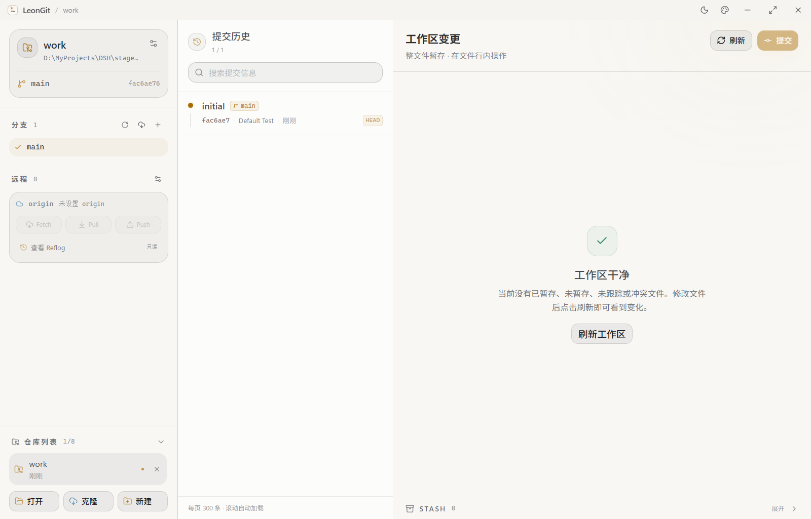

**当前阶段：V2 子阶段 C — Canvas DAG 只读视图与性能工程**

- Tauri 2 + Rust
- React 19 + TypeScript + Vite
- Tailwind CSS 4 + shadcn/ui
- `@tanstack/react-virtual` 虚拟滚动
- 亮色 / 暗色双主题，默认亮色，无跟随系统
- 自定义 32px 标题栏、18–28px 字体滑块（默认 20px）、多仓库切换
- 无账号、无云端同步、无遥测

## 已完成范围

Stage 1 基线：

- 原生目录选择器 + 拖拽打开仓库
- `.git` 校验、启动恢复仓库列表
- 系统 Git 克隆远程仓库
- 仓库配置读取 / 修改 `user.name` / `user.email`
- 工作区四类状态与三向文件 diff

Stage 2 能力：

- 整文件暂存 / 取消暂存 / 丢弃未暂存修改（丢弃带二次确认）
- 提交标题 + 可选正文，提交前查看完整已暂存 diff
- 提交后刷新工作区与历史
- 提交历史 300 条/页、虚拟滚动、键盘导航
- 提交详情、变更文件列表、逐文件 diff

Stage 3 新增：

- 本地分支列表：当前分支高亮，显示 upstream、ahead/behind、未合并标记
- 从当前 HEAD 或指定 commit 创建分支
- 切换分支：工作区有未提交修改时客户端明确拦截，后端再次校验
- 删除本地分支：未合并分支弹出强警告并二次确认
- 远程列表：展示 origin URL；支持添加/修改任意远程名与 URL
- Fetch：只更新远程跟踪分支，不改变工作区
- Pull：拉取当前分支，强制 `--no-rebase`；冲突时进入冲突状态
- Push：推送前二次确认；首次 Push 自动设置 upstream；不做 force push
- 冲突文件独立分组，显示“合并工具”和“标记已解决”
- 外部合并工具：调用用户系统 Git 配置的 `merge.tool`，不内置三栏编辑器
- 标记已解决：对冲突文件执行 `git add`
- Reflog：只读查看最近 100 条 HEAD 变动及完整 SHA
- 客户端不读取或存储密码/token，认证交给系统 Git 凭据管理器

Stage 4 新增：

- 提交面板、整文件暂存与分支操作均提供明确的按钮入口
- 提交历史点击行查看详情
- 所有主要面板覆盖加载 / 空 / 错误状态，不再出现空白面板
- 破坏性写入统一为“图标 + 说明 + 影响卡片 + 取消/确认”的二次确认样式
- 暗色主题覆盖弹窗、diff、错误提示、Reflog、分支面板与输入控件
- README 增加安装、操作说明、已知限制和凭据说明

Stage 5 新增（UI 架构调整，不新增 Git 功能）：

- 亮色为 `:root` 默认主题，暗色使用 `.dark`；不提供“跟随系统”
- `index.html` 内联启动脚本在 React 挂载前设置主题与字号，避免启动闪烁
- 主题与字号同时写入 localStorage 与 Rust 配置（Rust 为权威来源）
- 自定义 32px 无边框标题栏：拖拽、双击最大化、最小化/最大化/还原/关闭
- 标题栏按钮与可点击区域不继承拖拽属性；窗口控制状态与最大化事件同步
- 字体滑块 18–28px，1px 步进；**20px 为默认字号**，只改字体令牌，不改变布局结构
- 设置面板提供主题与字号入口；本版本不提供自定义快捷键
- 多仓库切换：前端维护 `activeRepoPath` 与 `repoList`，Rust 不保存“当前仓库”
- 仓库列表持久化到 `Data/config/repos.json`，最多 8 个，包含稳定 id
- 切换仓库时重置提交选择、工作区文件、分支、历史游标、diff 与冲突状态
- 旧仓库的异步响应带路径/序列守卫，不能覆盖新仓库 UI
- 所有成功/失败/警告通知统一显示在右下角，并可堆叠
- Fetch / Pull / Push / Clone 增加网络空闲超时与进程树终止；本地 Git 操作不受影响
- 分支区支持从远程跟踪分支恢复已删除的本地分支，并自动建立 tracking

V1.1 子阶段 A 新增：

- 在已有目录中初始化 Git 仓库，可指定初始分支；成功后仅加入仓库列表，不自动打开
- 远程新增与 URL 编辑拆分为严格检查的命令；不提供删除远程
- 提交历史支持按提交信息搜索，复用 V1 分页与虚拟滚动；清空关键词恢复普通历史
- 本地分支重命名；当前分支重命名时提示“远程跟踪未变”，不自动 push 或修改 upstream
- Stash 全套：保存（可含未跟踪）、列表、应用、弹出、单条删除；应用不删除条目，弹出失败保留条目

V1.1 子阶段 B 新增：

- Hunk 级暂存与取消暂存：前端展示 hunk 列表并构造 hunk patch，Rust 使用 `git apply --cached` / `--reverse`
- Amend 最近一次提交：可选补入暂存文件、可选改消息；二次确认并明确会改写历史
- 分支合并：`git merge --no-edit`；冲突时复用 V1 冲突分组与外部合并工具
- 提交并推送：组合命令，分别返回 commit SHA 与 push outcome；push 失败保留 commit 并提供重试入口

V2 子阶段 A 新增：

- 文件历史：`git log --follow -M -m`，重命名节点标注“重命名自 …”，合并提交中的文件变更可见
- Blame：`git blame --line-porcelain`，仅返回紧凑行范围归属；大文件使用虚拟滚动分段渲染
- Tag：本地附注/轻量标签的列表、创建、删除；删除二次确认；不提供 push tag
- 复用提交信息：从历史读取完整 message 填入提交编辑器；可选复用作者，后端使用 `--author`，不使用 `-C`

V2 子阶段 B 新增：

- 行级丢弃：在未暂存 diff 中勾选 + / - 行，确认后 `git apply --reverse`；不可恢复，确认文案明确提示
- Revert：`git revert --no-edit`，冲突进入持久化的“revert 进行中”，提供 continue / abort
- 跳过钩子：提交表单次级“更多”中可选 `--no-verify`，仅当次生效，不持久化

V2 子阶段 C 新增：

- DAG 只读视图：Canvas 单元素绘制，不逐节点创建 DOM/SVG
- 与扁平列表共享同一分页游标、`commit` 元数据和虚拟滚动；切换视图不重新拉取
- 前端增量泳道布局：分页拉取 SHA/父子关系，只把视口行送入 Canvas
- 5k/50k commits 首屏与滚动性能验证

未实现（按约束）：

- 交互式 rebase、cherry-pick、worktree、submodule、Git LFS
- 内置三栏合并编辑器
- 万能撤销（只提供 Reflog 只读查看）
- DAG 图中的任意写入操作（拖拽、rebase、cherry-pick）
- 远程分支删除 / 重命名（仅支持从已 Fetch 的远程分支恢复检出）
- force push

## 安装与启动

要求：

- Node.js 22.12+（`pnpm test:dag` 使用 Node 的 TypeScript 类型剥离能力）
- pnpm
- Rust stable
- 系统 Git（`git` 在 PATH 中）
- Windows WebView2 Runtime

从源码启动：

```bash
pnpm install
pnpm tauri dev
```

生产构建：

```bash
pnpm build:nsis
pnpm build:portable
```

等价的底层命令：

```bash
pnpm tauri build --bundles nsis
pnpm tauri build --no-bundle
```

安装了 cargo-tauri 后也可以使用：

```bash
cargo tauri build --bundles nsis
cargo tauri build --no-bundle
```

安装包使用 `currentUser` 模式，默认安装到 `%LOCALAPPDATA%\Programs\LeonGit`，无需管理员权限。便携模式的数据目录位于可执行文件旁的 `Data/` 与 `WebView2Data/`，详见 [docs/windows-packaging.md](docs/windows-packaging.md)。

凭据说明：

- 客户端不读取、不写入、不保存密码或访问 token。
- HTTPS/SSH 认证由系统 Git 凭据管理器处理。
- 远程 URL 不允许内嵌 HTTP(S) 凭据。

## 操作方式

本版本不提供自定义快捷键；除提交历史的键盘导航外，所有操作通过界面按钮与表单完成：

- 仓库：左栏底部“打开 / 克隆 / 新建（初始化）”；仓库列表可展开、折叠、切换与移除。
- 工作区：文件行内“暂存 / 丢弃”；文件较多时可用“全部暂存”；右侧“刷新”；暂存后点击“提交”。
- Hunk：在文件 diff 中选择“工作区”或“已暂存”，勾选 Hunk 后暂存/取消暂存；整文件暂存路径保持不变。
- Amend：工作区标题下方的次级入口“Amend 上次提交”，在确认弹窗中可选补入暂存文件或改消息。
- 分支合并：非当前分支行内的合并图标，确认后执行 merge；冲突复用 V1 冲突处理。
- 提交并推送：提交弹窗中的“提交并推送”按钮；push 失败不回滚 commit。
- Stash：工作区面板底部次级区域，支持保存、应用、弹出、单条删除。
- 分支：分支行切换/删除/重命名，“+”创建，云下载图标从远程跟踪分支恢复已删除分支；工作区有未提交修改时显示高对比度警告并拦截切换。
- 远程：Fetch / Pull / Push 按钮；Reflog 只读入口；齿轮打开远程列表，支持新增远程与修改 URL。
- 提交搜索：提交历史顶部输入关键词，自动搜索；清空后恢复普通历史。
- 文件历史：文件 diff 标题栏的时钟按钮；跟随重命名，重命名提交会标注旧路径。
- Blame：文件 diff 标题栏的人像按钮；按行显示归属，点击行打开对应提交；大文件只渲染可视行。
- Tag：分支区标题栏的标签按钮；创建附注/轻量标签，删除需二次确认，不 push。
- 复用提交信息：提交编辑器“从历史复用消息”；默认只复用 message，勾选后才复用作者。
- 行级丢弃：未暂存 diff 中勾选 + / - 行，点击“丢弃选中行”，确认后只恢复选中行。
- Revert：提交详情标题栏的 Revert 按钮；冲突时工作区显示“revert 进行中”，可 continue/abort。
- 跳过钩子：提交编辑器“更多 → 跳过 Git 钩子”；仅当次提交生效，启用时显示警告。
- DAG：提交历史右上角“列表 / DAG”切换；DAG 中点击提交仍打开右侧详情。
- 提交历史键盘：焦点移入列表后，`↑` / `↓` / `Home` / `End` 移动高亮，`Enter` 或空格打开详情；DAG 视图同样可用，不提供全局快捷键。
- 字体与主题：标题栏调色板打开“界面设置”，拖动字体滑块（18–28px）即时应用。
- 左栏不再放应用名/LOCAL 标记、仓库配置与界面设置按钮；仓库配置在当前仓库卡片右上角齿轮。
- 右键不弹出 WebView 原生菜单。

## 通知与网络超时

- 推送成功、拉取成功、操作失败、冲突警告等提示统一在**右下角**展示；多条提示纵向堆叠。
- 成功通知 6 秒后自动消失；失败提示保留到手动关闭。
- 所有远程操作（Fetch / Pull / Push / Clone）都带网络守卫：
  - HTTP 传输启用 `http.lowSpeedLimit=1`、`http.lowSpeedTime=30`。
  - stdout/stderr 连续 **30 秒无任何输出**视为连接或传输中断，自动终止 Git 进程树。
  - 绝对上限 **600 秒**，防止长时间无进展的进程永久占用。
  - 远程命令启用 `--progress`，让长时间传输保持活动状态。
  - 超时返回类型化 `timeout` 错误，界面显示“连接超时”，不会把 Git 原始输出透出。
- 本地 Git 操作不设置网络超时。

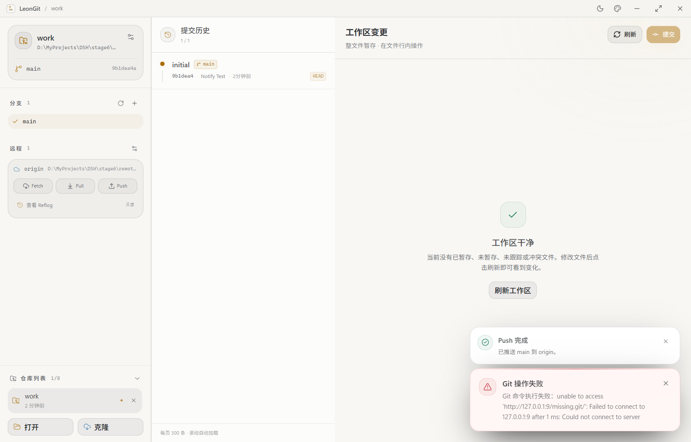

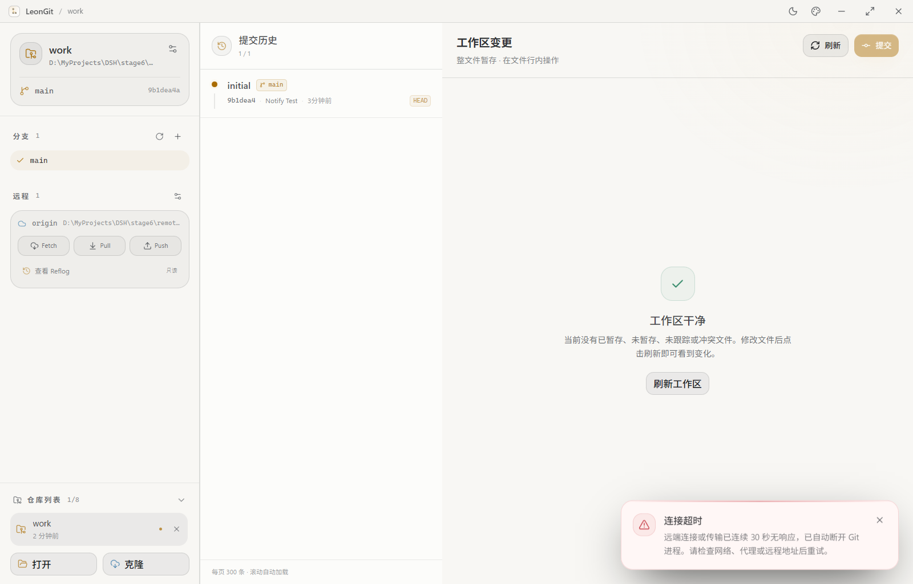

移除仓库列表条目只移除客户端记录，不会删除磁盘文件；移除当前仓库时自动切换到下一个仓库，只剩一个时回到欢迎页。

## 主题、字体与窗口外壳

- 亮色为默认主题；暗色由 `.dark` 类与 `dark` 数据属性共同标记，只提供亮/暗两态。
- 主题与字号在 React 挂载前由 `index.html` 内联脚本应用；Rust 侧 `ui.json` 是权威值，localStorage 只用于首帧去闪烁。
- 标题栏固定 32px，使用 `data-tauri-drag-region="deep"`；窗口按钮位于拖拽区之外。
- 最大化按钮与双击标题栏都走 Tauri 窗口命令；`onResized` 同步图标状态。
- 字体滑块范围 18–28px、1px 步进；20px 为默认字号，写入 `--display-scale = px / 16`，所有文字尺寸通过 `calc(px * var(--display-scale))` 派生；不使用 `set_zoom()` 或原生缩放。
- 设置面板（标题栏调色板）提供主题与字号滑块，并即时预览；拖动即可应用。
- 所有可点击的标题栏按钮均不继承拖拽；窗口按钮只响应自身点击。

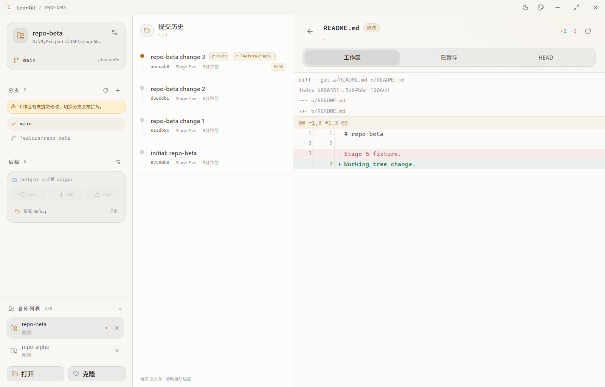

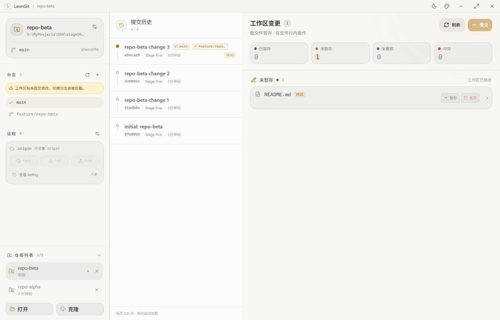

## 状态收口

- 提交历史：加载骨架、空仓库、错误 + 重试。
- 文件 diff：加载骨架、空 diff、二进制、截断、错误 + 重试。
- 提交详情：加载骨架、无文件、逐文件 diff 加载/错误。
- 分支面板：加载骨架、空列表、错误 + 重试；脏工作区显示高对比度拦截提示。
- 远程面板 / 远程对话框：读取中、未配置远程、错误提示。
- Reflog：加载、空记录、错误 + 重试。
- 工作区：干净状态、无提交状态、冲突分组。
- 主题、字号、窗口控制与仓库切换均有明确的加载/空/错误状态。
- 所有弹框统一为“固定标题（图标与标题同一行）+ 可滚动内容区 + 固定底部按钮”：长表单、diff、标签/Reflog 列表只在中间区域滚动，关闭按钮与确认/取消按钮始终可见。

## 多仓库切换

- 左栏“仓库列表”最多保留 8 个仓库，当前仓库高亮；最近打开的仓库排在最前。
- 前端维护 `activeRepoPath` 与 `repoList`；Rust 不保存活动仓库，所有仓库命令都带显式 `repoPath`。
- 列表持久化在应用旁的 `Data/config/repos.json`（便携版与 currentUser 安装版都在可执行文件所在目录的 `Data/` 下）。
- 每个条目包含 `path`、显示名、`openedAt` 和基于规范化路径的稳定 id。
- 列表位于左栏下方，可折叠/展开；“打开 / 克隆”固定在列表下方。
- 当前仓库条目也显示移除按钮：有下一个仓库时自动切换，只剩一个时回到欢迎页；不会删除磁盘文件。
- 切换成功后重置提交选择、文件选择、diff、分支列表、冲突状态和历史游标；滚动分页重新从 0 开始。
- 旧仓库的列表/详情/diff 响应按请求序列或路径丢弃；写入操作进行中会阻止切换，避免跨仓库写入竞争。

## 从远程恢复分支

- 删除本地分支后，只要远程跟踪引用仍在，即可从分支区标题右侧的云下载图标恢复。
- 弹窗列出所有尚未存在本地的远程分支（例如 `origin/feature/restore`）。
- 点击“检出”等价于 `git switch --create <branch> --track <remote>/<branch>`，会创建本地分支、设置 upstream 并切换过去。
- 工作区不干净、本地同名分支已存在、远程引用尚未 Fetch 时，会明确拒绝并给出原因。
- 若列表为空，请先在远程区执行 Fetch；恢复操作本身不发起网络请求。
- 恢复成功通知和其他操作提示一样显示在右下角。

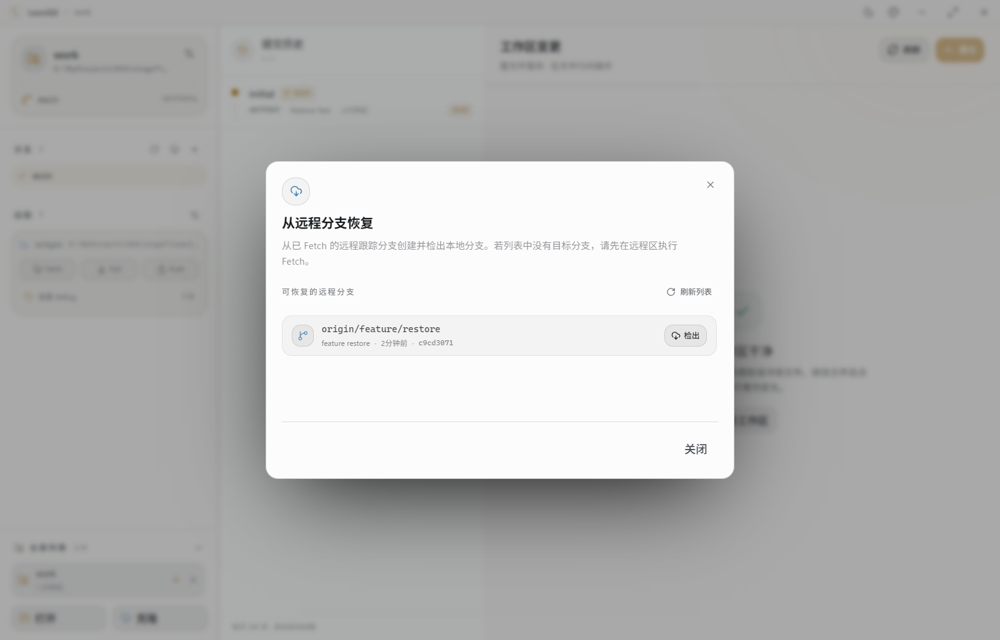

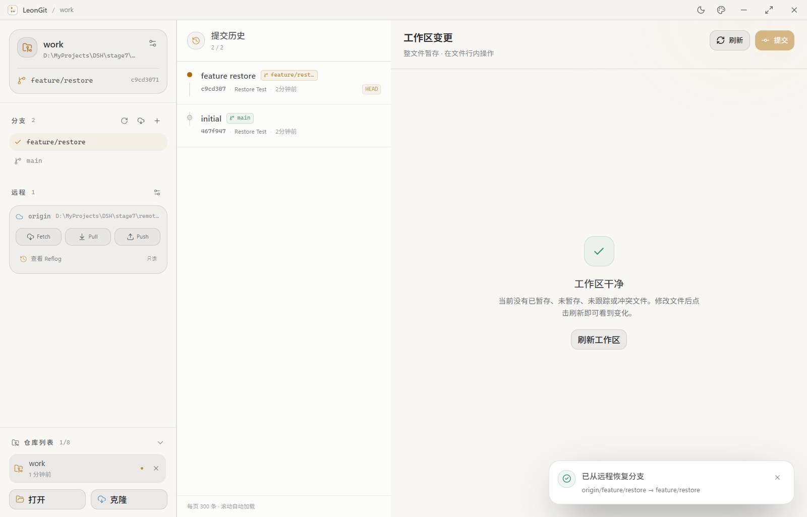

## V1.1 子阶段 A 工作流

### 仓库初始化

- 左栏“新建”或欢迎页“初始化仓库”。
- 仅允许已有目录；如果目录已存在 `.git`，返回“该目录已经是 Git 仓库，不能重复初始化”。
- 可选初始分支，使用 `git init --initial-branch <branch>`；分支名在初始化前校验。
- 成功后只把仓库写入列表，不自动打开，也不改变当前仓库。

### 远程新增与 URL 编辑

- `add_remote` 在添加前检查同名 remote；`set_remote_url` 在修改前检查 remote 存在。
- 前端根据当前 remote 名决定“新增”还是“更新 URL”，修改后刷新远程列表。
- 远程列表和错误信息中的 HTTP(S) userinfo 会脱敏；已有凭据 URL 只显示主机与路径。
- 不支持删除远程；URL 仍禁止内嵌 HTTP(S) 凭据。

### 提交搜索

- 提交历史顶部输入关键词；300ms 防抖后调用 `search_commits`。
- Git 参数逐个传递：`--grep` 与 pattern 分开、`--max-count` 与数量分开；不拼接 shell 命令。
- 复用 V1 的 300 条分页 + 虚拟滚动；清空输入恢复普通历史。
- 空关键词被 Rust 拒绝；无匹配时显示“没有匹配的提交”。

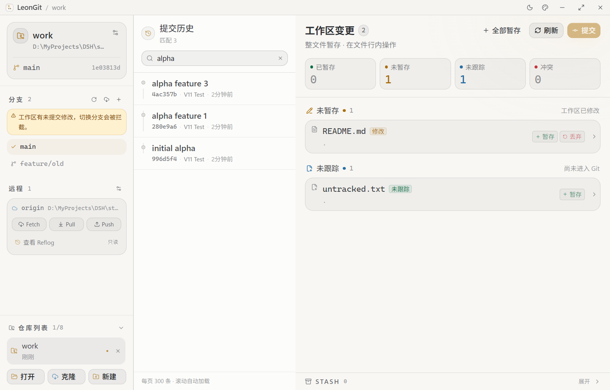

### 分支重命名

- 分支行铅笔图标打开重命名对话框，执行 `git branch -m <old> <new>`。
- 新名字已存在时返回明确错误。
- 重命名当前分支时返回 `needsUpstreamNote: true`，提示“远程跟踪未变”；不会自动 push 或修改 upstream。

### Stash

- 位于工作区面板底部次级区域，默认折叠。
- 保存支持说明与“包含未跟踪文件”；列表、应用、弹出、单条删除。
- `apply` 成功不删除条目；`pop` 失败（包括冲突）时条目仍保留，并在右下角明确提示。
- 单条删除前需要二次确认；不提供“删除全部”。
- `恢复索引状态（--index）` 默认开启，可关闭。

## V1.1 子阶段 B 工作流

### Hunk 级暂存

- 文件 diff 的“工作区”/“已暂存”视图会列出 `@@` hunk；勾选一个或多个 hunk 后需要再次点击确认，才会暂存/取消暂存。
- 前端只构造 hunk 头与 diff 行，Rust 校验后补上可信的 `diff --git` 文件头，再用 `git apply --cached` 写入索引。
- 取消暂存使用同一 patch 加 `--reverse`。
- 整文件暂存和 hunk 暂存共用 `refreshIndexView()`：更新快照、递增索引修订，并同时刷新工作区/暂存区两份 diff；不会出现两侧重复 hunk。
- 不依赖 `git add -p`；二进制、截断 diff、重命名文件和未跟踪文件不显示 hunk 操作。
- patch 失败时返回 Git 原始 stderr（凭据会脱敏），前端保留当前 diff 与选择，并在右下角提示。

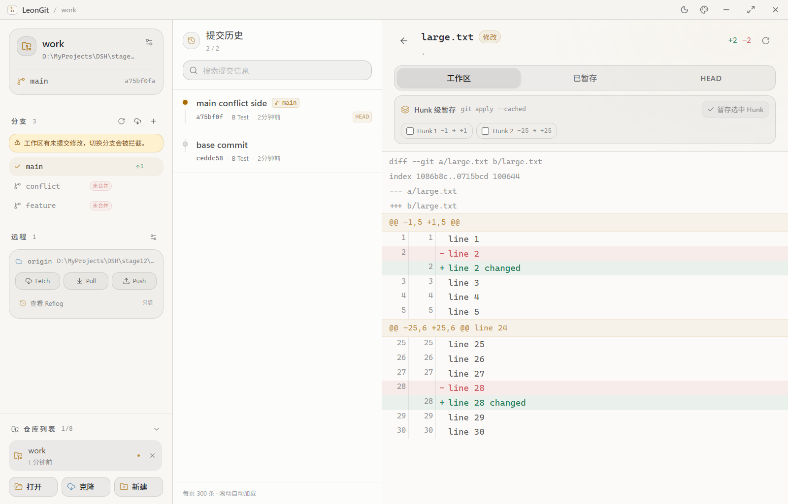

### Amend

- 入口在工作区标题下方，处于次级位置，不与“提交”并列。
- 弹窗明确提示“会改写最近一次提交的历史”，并作为二次确认。
- 留空消息 → `git commit --amend --no-edit`；填写消息 → `git commit --amend -m <message>`。
- “包含当前暂存文件”默认按当前索引状态选择；未勾选但存在暂存文件时 Rust 明确拒绝。
- 不 push，不 reset。

### 分支合并

- 非当前分支行的合并图标打开确认弹窗，目标始终是当前分支。
- 执行 `git merge --no-edit <source_branch>`；工作区不干净时 Rust 直接拦截，不会自动 stash。
- 退出码 0 → 成功；退出码 1 且存在冲突 → 返回冲突文件列表和快照；其他退出码 → 错误。
- 冲突文件进入 V1 已有的“冲突”分组，可继续使用外部合并工具和标记已解决。
- 合并本身不 push。

### 提交并推送

- 提交弹窗中的“提交并推送”是两步组合：先复用 V1 commit，再 push。
- 没有 upstream 时使用 `--set-upstream origin <current_branch>`。
- 返回 `CommitPushResult { commitSha, commitShortSha, push, pushMessage, snapshot }`。
- `push` 区分 `success / authFailed / nonFastForward / networkError / other`。
- commit 成功但 push 失败时保留提交，右下角提示失败原因与 commit SHA，并提供“重试 Push”按钮（打开现有 Push 二次确认）。
- 任何 push 失败都不会执行 reset 或其他历史改写。

## V2 子阶段 A 工作流

### 文件历史

- 文件 diff 标题栏的时钟按钮打开“文件历史”。
- Rust 执行 `git log --follow -M -m --name-status`，分页读取；`--follow` 跟随重命名，`-m` 让合并提交中修改的文件可见。
- 前端复用分页 + 虚拟滚动；每页 100 条，滚动加载。
- `--name-status` 的 `R` 记录会写入 `renamedFrom`，UI 标注“重命名自 <old_path>”。
- 文件在 HEAD 中不存在、未跟踪或没有历史时显示明确空状态。

### Blame

- 文件 diff 标题栏的人像按钮打开 Blame。
- Rust 执行 `git blame --line-porcelain -- <file>`，解析 40/64 位 SHA 头、`author`、`author-time`、`author-tz`，合并连续行范围后返回紧凑 `BlameLineMeta`。
- 前端同时读取文件文本，按行显示归属；点击归属打开 V1 提交详情。
- 大文件策略：Blame 结果按连续范围压缩，不传输完整 commit message；文件最多 5 MiB，前端使用虚拟滚动仅渲染可视行（>2000 行同样不冻结 UI）。

### Tag

- 分支区标题栏标签按钮打开“标签”对话框。
- 列表使用 `for-each-ref refs/tags`，区分附注标签（objecttype=tag）与轻量标签（objecttype=commit）。
- 创建默认附注；附注必须填写消息。目标必须是完整 commit SHA。
- 删除单条标签，需要行内二次确认；没有批量删除。
- Tag 只写本地 refs/tags，不提供 push tag，也不会自动推送。

### 复用提交信息

- 提交编辑器“从历史复用消息”打开最近 100 条提交选择器。
- 选择后读取完整 `CommitDetail.message`，自动拆为标题与正文填入编辑器；用户可继续编辑。
- 默认只复用 message；“同时复用作者信息”勾选后，提交时通过 `--author` 传递作者名与邮箱。
- 后端不使用 `git commit -C`，也没有静默复用。

## V2 子阶段 B 工作流

### 行级丢弃

- 只在未暂存（工作区）diff 中启用；整文件丢弃仍走 V1 路径。
- 前端复用已有 diff hunk 解析，勾选 addition/deletion 行后在原 hunk 上构造局部反 patch；Rust 使用 `git apply --reverse` 写工作区，不碰索引。
- 确认弹窗必须包含文件名、受影响行范围和：
  “此操作不可恢复，丢弃的修改不会进入 stash 或任何备份。”
- 不提供撤销按钮；成功或失败后都通过共享 `refreshIndexView()` 重载 diff。
- patch 失败返回 Git 原始 stderr（凭据脱敏），UI 保留可操作状态。

### Revert

- 提交详情标题栏 Revert 按钮；确认后执行 `git revert --no-edit <sha>`。
- 结果区分 `success / conflict / inProgress / otherError`。
- 退出码 0 → 成功；退出码 1 或检测到 `.git/REVERT_HEAD` → 冲突。
- 冲突后快照标记 `revertInProgress`，工作区顶部持续显示“revert 进行中”，提供 continue 和 abort。
- continue 前检查无 unmerged 路径，否则阻止；不会自动 continue/abort。
- 客户端启动时从快照恢复 `revertInProgress`，不会隐藏遗留状态。
- 成功/中止均刷新快照、历史与 refs。

### 跳过 Git 钩子

- 提交编辑器“更多”次级菜单中的本地开关，默认关闭，不持久化。
- 后端 `commit_staged` / `commit_and_push` 增加可选 `no_verify`，为 true 时添加 `--no-verify`。
- 启用时 inline 警告：“将跳过 pre-commit 和 commit-msg 钩子，可能绕过代码检查”。
- 提交成功后不额外提示“钩子已跳过”。

## V2 子阶段 C 工作流

### 技术选型

- 渲染层使用 **Canvas**，不使用 SVG 或 DOM 逐节点渲染。
- 原因：5k commits 的 DOM/SVG 方案会产生上万个节点和边，hover/选中带来大量布局与重绘；Canvas 始终只有一个元素，绘制成本与可见行相关。
- 只有 DAG 列使用 Canvas；提交摘要、refs、点击和详情仍由现有虚拟列表行提供。

### 数据层

- 不新增全量图 IPC。沿用 `list_commits` 的 300 条分页；每页已有 `sha / parents / refs / author / time / subject`。
- DAG 与扁平列表共用 `useCommitHistory`，切换只改变视图状态，不重新请求。
- `use-dag-layout` 只在 DAG 视图启用：列表视图不构建图模型；首次打开 DAG 时一次性布局已加载页，之后随分页追加增量布局。
- 切仓、刷新或搜索词变化时重置布局缓存。
- 搜索结果为过滤集合、缺少父提交，无法形成连续图；搜索词非空时 DAG 按钮禁用并提示，自动回到列表。
- 已加载图模型只保存紧凑行（commit 行、泳道、incoming/continuing/parent lane），不保存全量边对象。
- Canvas 只绘制当前视口及前后 2 行；50k commits 不会创建 50k 个 DOM 节点。

### 泳道布局

- `src/lib/dag-layout.ts` 与渲染层完全分离，可直接用 Node 运行单元测试。
- `lanes[]` 保存每条活跃泳道等待的下一个 SHA；merge 时关闭多余等待泳道，并在子行画合并曲线；分叉时为额外父提交分配泳道。
- 同泳道垂直直线；跨泳道使用二次贝塞尔曲线在行内移动，剩余部分继续垂直。
- 泳道颜色读取 `--dag-1..8` 与 `--dag-selected` 主题变量，切换亮/暗主题时自动重绘。
- 泳道区宽度按已加载历史的最大泳道数在 140–220px 之间增长；达到上限后间距自动压缩，最右侧泳道始终留在画布内，不会被裁掉。
- 单页 300 条，前端增量布局；最大已加载行数随滚动增长，不一次性构造全量数据。

### 与 V1 列表关系

- 提交历史右上角“列表 / DAG”切换；默认仍是 V1 扁平列表。
- 两种视图共享分页游标、虚拟滚动、选中状态和 `onSelectCommit` 详情链路。
- 搜索是列表能力：搜索词非空时 DAG 按钮禁用并显示原因，避免把不连续的过滤结果画成错误拓扑。
- 列表与 DAG 都支持键盘导航：焦点移入列表后用 `↑` / `↓` / `Home` / `End` 移动高亮，`Enter` 或空格打开详情。
- DAG 行仍展示相同的 refs、作者、时间和短 SHA。

### 性能验证

- 5k commits：DAG 首屏可见，滚动加载新页，合并/分叉线连续。
- 50k commits：首屏 300 条；切换 DAG 对已加载页做一次性布局并只绘制视口；滚动增量加载到 1,500 条时仍只渲染约 30 个 DOM 行，无 UI 冻结。
- 50k 测试未一次拉取全量数据；切换列表/DAG 不新增 IPC 请求。

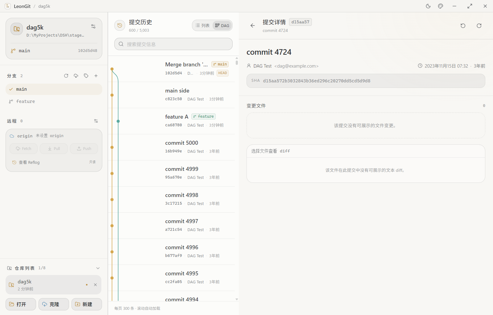

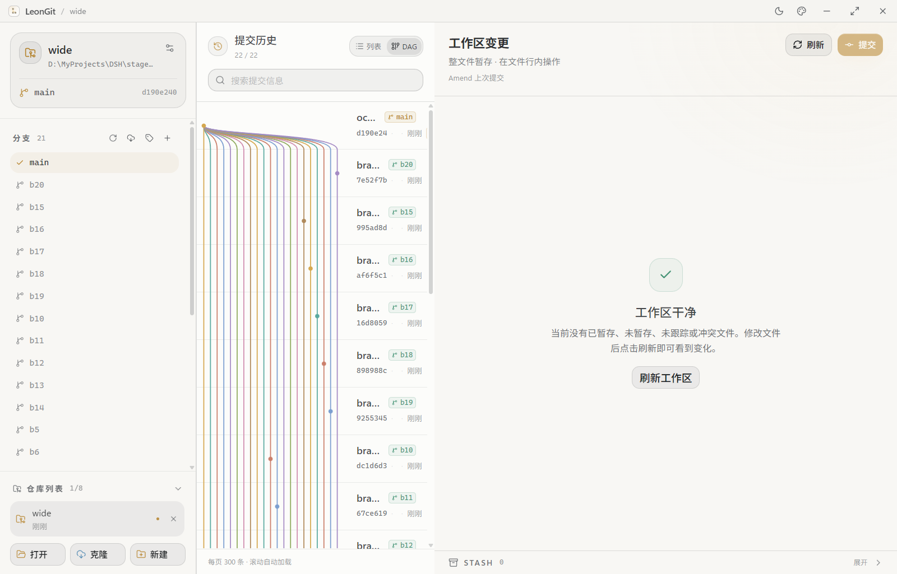

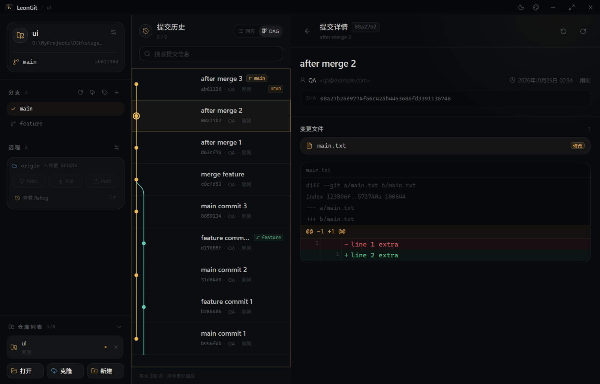

## 开发

要求：Node.js 22.12+、pnpm、Rust stable、系统 Git、Windows WebView2。

```bash
pnpm install
pnpm tauri dev
```

前端构建与类型检查：

```bash
pnpm build
```

Rust 测试与 lint：

```bash
cargo test --manifest-path src-tauri/Cargo.toml
cargo clippy --manifest-path src-tauri/Cargo.toml --all-targets -- -D warnings
```

Windows 打包：

```bash
pnpm build:nsis
pnpm build:portable
```

打包与便携数据路径见 [docs/windows-packaging.md](docs/windows-packaging.md)。

## 架构

```text
src/
  components/
    title-bar.tsx             自定义 32px 标题栏、窗口控制、主题入口
    appearance-settings-dialog.tsx 主题与字体滑块
    workspace-sidebar.tsx     当前仓库、仓库列表、分支/远程导航
    branch-section.tsx        分支列表、切换/删除/重命名、远程恢复入口
    remote-section.tsx        origin、fetch/pull/push、reflog 入口
    branch-create-dialog.tsx  从 HEAD/指定 commit 创建分支
    branch-rename-dialog.tsx  本地分支重命名
    merge-branch-dialog.tsx   合并分支二次确认
    amend-commit-dialog.tsx   Amend 最近一次提交
    branch-delete-dialog.tsx  未合并分支强确认
    push-confirm-dialog.tsx   Push 二次确认
    init-repository-dialog.tsx 空目录 git init 与初始分支
    remote-branch-dialog.tsx  从远程跟踪分支恢复已删除的本地分支
    remote-dialog.tsx         远程地址列表、新增与 URL 编辑
    reflog-dialog.tsx         Reflog 只读列表
    stash-panel.tsx           Stash 保存、列表、应用、弹出、单条删除
    working-tree-overview.tsx 冲突分组、Stash 次级区域、Amend 入口
    commit-history.tsx        分页 + 虚拟滚动 + 提交搜索 + 列表/DAG 切换
    dag-canvas.tsx            Canvas 只读 DAG 泳道与连线，只绘制视口行
    diff-view.tsx             diff、比较层、Hunk 暂存、行级丢弃确认
    revert-confirm-dialog.tsx Revert 提交确认
    revert-banner.tsx         revert 进行中与 continue/abort
    commit-detail.tsx         提交详情、逐文件 diff、Revert 入口
    commit-dialog.tsx         提交面板、提交并推送、完整暂存 diff、复用历史消息
    commit-message-picker.tsx  最近提交消息与作者选择
    file-history-dialog.tsx   文件历史分页 + 虚拟滚动 + 重命名标注
    blame-dialog.tsx          文件逐行 Blame 与提交跳转
    tag-dialog.tsx            本地标签列表、创建、删除确认
    diff-lines.tsx            类型化 diff 行渲染
  hooks/
    use-ui-state.ts           主题、字号、仓库列表与持久化
    use-repository-refs.ts    分支 + 远程列表
    use-commit-history.ts     300 条/页增量历史与搜索分页
    use-dag-layout.ts         按需构建 DAG 行模型；列表视图不计算，切仓/刷新重置
    use-file-history.ts       文件历史分页 + 虚拟滚动
    use-commit-detail.ts      提交详情
    use-file-diff.ts          工作区/暂存区/HEAD diff
    use-repository.ts         仓库快照与旧仓库响应守卫
  lib/
    git-api.ts                唯一 Git IPC 封装；不存在前端 Git 命令
    dag-layout.ts             纯函数泳道布局（lanes 状态、合并/分叉、行包装）
    ui-api.ts                 UI 偏好与仓库列表 IPC 封装
src-tauri/src/
  ui_state.rs                 主题、字号、repos.json 稳定 id 与原子写入
src-tauri/src/git_engine/
  command.rs                  无 shell 的 Git CLI 封装；远程超时与进程树终止
  repository.rs               仓库发现、初始化与快照
  branches.rs                 分支列表、创建、切换、删除、重命名、远程恢复
  remotes.rs                  远程列表、add、set-url
  log.rs                      分页历史、搜索、--follow 文件历史
  blame.rs                    porcelain blame 解析与行范围聚合
  tags.rs                     本地标签列表、附注/轻量创建、删除
  file_content.rs             Blame 文件文本读取
  stash.rs                    stash push/list/apply/pop/drop
  hunk.rs                     hunk patch 校验、apply --cached 与行级 discard --reverse
  revert.rs                   revert / continue / abort 与 REVERT_HEAD 状态
  actions.rs                  暂存、提交、Amend、提交并推送、no_verify
  sync.rs                     fetch / pull / push
  merge.rs                    分支合并、外部合并工具、标记已解决
  reflog.rs                   HEAD reflog 只读
  status.rs                   porcelain v2 -z 解析
  diff.rs                     类型化 diff、行号与截断保护
  commit_detail.rs            提交元数据、文件列表、提交文件 diff
  config.rs / clone.rs        Stage 1 仓库配置与克隆
src-tauri/windows/
  installer.nsi              Tauri NSIS 模板（currentUser 路径改为 Programs）
  nsis-hooks.nsh             Windows 安装/卸载钩子
```

约束：

- 所有 Git 命令集中在 `git_engine`；前端只消费类型化 DTO。
- Git 写操作只通过本地 Git CLI；未引入 git2-rs 写入。
- 新命令的前端路径统一经过 `safe_repo_path()`；初始化目录单独做 `git init` 目录校验。
- 所有 Git 参数逐个 `.arg()` 传入，不使用 shell 或拼接命令行；搜索 pattern 作为独立参数。
- Hunk patch 只接受 `@@` 与 diff 行，文件头由 Rust 用已验证的 filePath 补齐；失败返回原始 stderr。
- 整文件暂存与 hunk 暂存共用 `refreshIndexView()`，不各自维护索引刷新逻辑。
- Amend 仅改写最近提交；合并前工作区不干净时直接拦截，不自动 stash；提交并推送在 push 失败时不 reset。
- 文件历史与 Blame 是纯只读命令，不写工作区、索引或 refs。
- Tag 只写本地 refs/tags；不 push tag，不做批量删除。
- 复用作者使用 `git commit --author`，不使用 `git commit -C`。
- 行级丢弃只写工作区（`git apply --reverse`，不带 `--cached`），不提供撤销。
- Revert 冲突只记录状态，不自动 continue/abort。
- `no_verify` 只对当次 commit 添加 `--no-verify`，不持久化。
- Pull 固定 `--no-rebase`；不执行 rebase/cherry-pick/worktree/submodule/LFS。
- Fetch 使用 `git fetch origin`，不改变工作区；不自动 prune。
- 当前分支切换、Pull、Push、提交、分支删除、重命名、合并、Amend、Tag 删除、丢弃、Stash 单条删除均有前端拦截或二次确认。
- Push 使用 current branch；没有 upstream 时用 origin 并 `--set-upstream`。
- 外部合并工具完全由 `git mergetool` 调用用户配置，应用不内置编辑器。
- Reflog 只读；不提供“万能撤销”。
- DAG 视图完全只读：没有拖拽、rebase、cherry-pick 等写入入口，布局也不回写任何 ref。
- DAG 不跨仓库；只展示当前仓库已加载的分页提交。
- DAG 与列表共用同一份分页数据和游标，切换视图不触发新的历史请求。
- 图布局在 `src/lib/dag-layout.ts` 中为纯函数，可脱离 UI 用 `pnpm test:dag` 验证。
- 前端不解析 Git 原始输出；`GitError` 与各类结果均为类型化 DTO。
- 仓库相关命令全部显式接收 `repoPath`；Rust 不保存全局“当前仓库”。
- `activeRepoPath` 与 `repoList` 由前端维护；切仓时旧请求按路径/序列丢弃。
- 客户端不保存密码/token。

## IPC

| Command | 参数 | 返回 |
| --- | --- | --- |
| `open_repository` | `path` | `RepositorySnapshot` |
| `init_repository` | `path, initialBranch` | `void` |
| `clone_repository` | `url, targetPath` | `RepositorySnapshot` |
| `get_repository_config` | `repoPath` | `RepositoryConfig` |
| `save_repository_identity` | `repoPath, name, email` | `RepositoryConfig` |
| `get_file_diff` | `repoPath, path, originalPath, scope` | `FileDiff` |
| `list_commits` | `repoPath, offset, limit` | `CommitPage` |
| `search_commits` | `repoPath, pattern, page, pageSize` | `CommitPage` |
| `file_history` | `repoPath, filePath, page, pageSize` | `CommitPage` |
| `blame_file` | `repoPath, filePath` | `BlameLineMeta[]` |
| `read_file_lines` | `repoPath, filePath` | `string[]` |
| `list_tags` | `repoPath` | `TagEntry[]` |
| `create_tag` | `repoPath, name, targetSha, annotated, message` | `TagEntry[]` |
| `delete_tag` | `repoPath, name` | `TagEntry[]` |
| `stage_file` | `repoPath, path` | `RepositorySnapshot` |
| `stage_hunk` | `repoPath, filePath, hunkPatch` | `void` |
| `unstage_hunk` | `repoPath, filePath, hunkPatch` | `void` |
| `discard_lines` | `repoPath, filePath, reversePatch` | `void` |
| `unstage_file` | `repoPath, path, originalPath` | `RepositorySnapshot` |
| `discard_file` | `repoPath, path, originalPath` | `RepositorySnapshot` |
| `get_staged_diffs` | `repoPath` | `FileDiff[]` |
| `commit_staged` | `repoPath, title, body, noVerify` | `CommitResult` |
| `commit_staged_with_author` | `repoPath, title, body, authorName, authorEmail, noVerify` | `CommitResult` |
| `commit_and_push` | `repoPath, title, body, noVerify` | `CommitPushResult` |
| `commit_and_push_with_author` | `repoPath, title, body, authorName, authorEmail, noVerify` | `CommitPushResult` |
| `revert_commit` | `repoPath, sha` | `RevertResult` |
| `revert_continue` | `repoPath` | `RevertResult` |
| `revert_abort` | `repoPath` | `RevertResult` |
| `amend_commit` | `repoPath, message, includeStaged` | `void` |
| `get_commit_detail` | `repoPath, oid` | `CommitDetail` |
| `get_commit_file_diff` | `repoPath, oid, path, originalPath` | `FileDiff` |
| `list_branches` | `repoPath` | `BranchInfo[]` |
| `create_branch` | `repoPath, name, startPoint` | `BranchInfo[]` |
| `checkout_branch` | `repoPath, name` | `RepositorySnapshot` |
| `delete_branch` | `repoPath, name, force` | `BranchInfo[]` |
| `rename_branch` | `repoPath, oldName, newName` | `RenameBranchResult` |
| `list_remotes` | `repoPath` | `RemoteInfo[]` |
| `list_remote_branches` | `repoPath` | `RemoteBranchInfo[]` |
| `restore_remote_branch` | `repoPath, remote, branch` | `RepositorySnapshot` |
| `add_remote` | `repoPath, name, url` | `RemoteInfo[]` |
| `set_remote_url` | `repoPath, name, url` | `RemoteInfo[]` |
| `set_remote` | `repoPath, name, url` | `RemoteInfo[]` |
| `fetch_remote` | `repoPath` | `SyncResult` |
| `pull_current_branch` | `repoPath` | `SyncResult` |
| `push_current_branch` | `repoPath` | `SyncResult` |
| `merge_branch` | `repoPath, sourceBranch` | `MergeResult` |
| `open_merge_tool` | `repoPath, path` | `RepositorySnapshot` |
| `mark_conflict_resolved` | `repoPath, path` | `RepositorySnapshot` |
| `list_reflog` | `repoPath, limit` | `ReflogEntry[]` |
| `stash_push` | `repoPath, message, includeUntracked` | `void` |
| `stash_list` | `repoPath` | `StashEntry[]` |
| `stash_apply` | `repoPath, index, restoreIndex` | `void` |
| `stash_pop` | `repoPath, index, restoreIndex` | `void` |
| `stash_drop` | `repoPath, index` | `void` |
| `load_ui_state` | — | `UiState` |
| `save_ui_preferences` | `theme, fontScale` | `void` |
| `save_repo_list` | `repos` | `RepoEntry[]` |

关键返回类型：

```rust
pub struct BranchInfo {
    pub name: String,
    pub oid: String,
    pub short_oid: String,
    pub is_current: bool,
    pub upstream: Option<String>,
    pub ahead: u32,
    pub behind: u32,
    pub is_merged: bool,
    pub last_subject: String,
    pub last_committed_at: i64,
}

pub struct SyncResult {
    pub action: SyncAction,
    pub outcome: SyncOutcome, // completed | conflict
    pub remote: String,
    pub branch: Option<String>,
    pub conflicts: u32,
    pub snapshot: RepositorySnapshot,
}

pub struct ReflogEntry {
    pub oid: String,
    pub short_oid: String,
    pub selector: String,
    pub action: String,
    pub timestamp: i64,
    pub author: String,
}

pub struct StashEntry {
    pub index: u32,
    pub selector: String,
    pub oid: String,
    pub short_oid: String,
    pub message: String,
    pub timestamp: i64,
}

pub struct RenameBranchResult {
    pub old_name: String,
    pub new_name: String,
    pub needs_upstream_note: bool,
}

pub struct MergeResult {
    pub outcome: MergeOutcome, // success | conflict
    pub source_branch: String,
    pub conflicts: Vec<String>,
    pub snapshot: RepositorySnapshot,
}

pub struct CommitPushResult {
    pub commit_sha: String,
    pub commit_short_sha: String,
    pub push: PushOutcome, // success | authFailed | nonFastForward | networkError | other
    pub push_message: String,
    pub snapshot: RepositorySnapshot,
}

pub struct BlameLineMeta {
    pub sha: String,
    pub author: String,
    pub time: i64,
    pub author_tz: String,
    pub start_line: u32,
    pub line_count: u32,
}

pub struct TagEntry {
    pub name: String,
    pub target_sha: String,
    pub annotated: bool,
    pub message: String,
    pub timestamp: i64,
}

pub struct RevertResult {
    pub outcome: RevertOutcome, // success | conflict | inProgress | otherError
    pub conflicts: Vec<String>,
    pub message: String,
    pub snapshot: RepositorySnapshot,
}
```

## 冲突处理

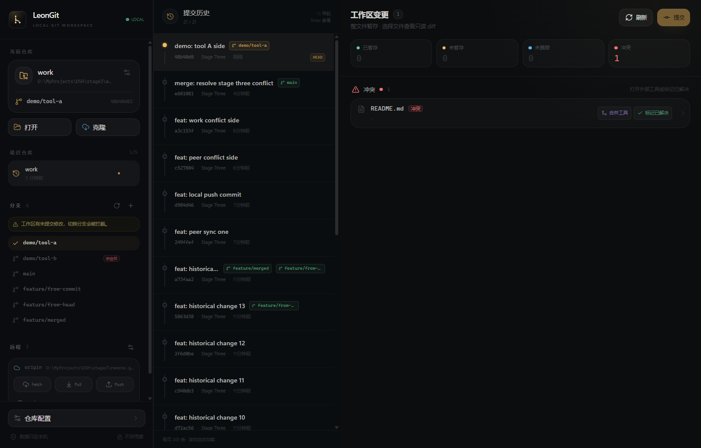

冲突不会由客户端自动解决，也不会打开内置编辑器。点击“合并工具”后，Rust 调用：

```bash
git -c mergetool.keepBackup=false mergetool --no-prompt -- <conflicted-file>
```

实际工具由仓库/全局 Git 配置的 `merge.tool` 决定。工具关闭后刷新快照；如果仍存在冲突，可以继续处理，或点击“标记已解决”执行 `git add`。

## Reflog

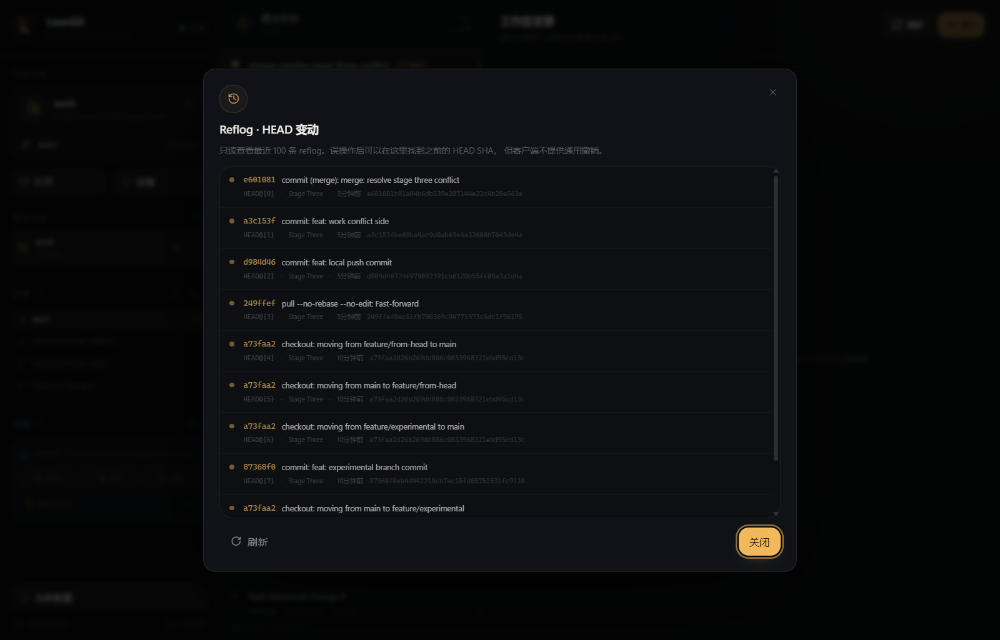

只读显示最近 100 条 HEAD 变动，包括 selector、动作、作者、时间和完整 SHA。误操作后可以在这里定位之前的 HEAD，但客户端不会自动 reset 或执行“万能撤销”。

## 手动验收

前置：Git 可用；准备一个可以修改的测试仓库。建议使用一个本地 bare 仓库模拟远程，无需 GitHub/Gitee。

### 0. 准备本地 bare 远程

在已有仓库同级目录创建：

```bash
git init --bare leongit-remote.git
git -C leongit-remote.git symbolic-ref HEAD refs/heads/main
```

在测试仓库中：

```bash
git remote add origin ../leongit-remote.git
git push -u origin main
```

另建一个 peer 克隆用于模拟协作者：

```bash
git clone ../leongit-remote.git peer
```

### 1. 分支列表与切换拦截

1. 启动：
   ```bash
   pnpm tauri dev
   ```
2. 打开测试仓库，左栏应显示本地分支、当前分支高亮、`ahead/behind`（若配置了 upstream）以及未合并分支标记。
3. 切换分支：点击非当前分支名。工作区干净时应成功切换，提交历史和当前分支同步更新。
4. 拦截：修改一个已跟踪文件但不提交，再点击其他分支。应出现“工作区还有 N 项未提交修改，已阻止切换…”的提示，且 `git rev-parse --abbrev-ref HEAD` 不变。
   ```bash
   git status --short
   git rev-parse --abbrev-ref HEAD
   ```

### 2. 创建分支与未合并分支删除

1. 点击分支区 `+`，输入 `feature/from-head`，起始提交留空，创建。
2. 点击新分支名切换，确认左栏当前分支高亮与 `git branch -vv` 一致。
3. 在提交历史选中任意提交，点击 `+`；起始提交应自动填入该 commit SHA，创建 `feature/from-commit`。
4. 创建一个未合并分支：
   ```bash
   git switch -c feature/unmerged
   echo "branch only" > branch-only.txt
   git add branch-only.txt
   git commit -m "branch only commit"
   git switch main
   ```
   在客户端点击该分支行的删除按钮。应出现“删除未合并分支？”强警告；确认后才删除。
5. 交叉验证：
   ```bash
   git branch -vv
   ```

### 3. 远程列表与地址修改

1. 左栏“远程”应显示 `origin` URL。
2. 点击远程区齿轮，打开“远程地址”对话框；应列出所有远程。
3. 在表单中填写新远程名（例如 `backup`）和本地 bare 路径，点击“保存远程地址”。
4. 重新打开对话框，确认列表中出现新远程；`git remote -v` 应一致。

### 4. Fetch / Pull / Push（本地 bare）

1. Peer 产生一个提交并推送：
   ```bash
   cd peer
   echo "peer sync" >> app.txt
   git add app.txt
   git commit -m "peer sync"
   git push
   ```
2. 回到客户端点击 `Fetch`。应提示 Fetch 完成；工作区文件不应改变；分支行的 behind 数应增加。
   ```bash
   git -C work status --short
   git -C work log --oneline -1 origin/main
   ```
3. 点击 `Pull`。当前分支应快进或合并到远程提交：
   ```bash
   git -C work log --oneline -3
   ```
4. 在工作仓库本地提交一次，再点击 `Push`。应出现“推送当前分支？”确认框；确认后：
   ```bash
   git -C work branch -vv
   git -C work log -1 --oneline
   ```
   没有 upstream 的新分支首次 Push 后，应显示 `[origin/<branch>]`。

### 5. 制造 Pull 冲突

在 peer 和 work 中修改同一个文件并分别提交，先推 peer：

```bash
# peer
cd peer
git pull --no-rebase
printf 'peer conflict\n' > app.txt
git add app.txt
git commit -m "peer conflict"
git push

# work
cd ../work
printf 'work conflict\n' > app.txt
git add app.txt
git commit -m "work conflict"
```

在客户端点击 `Pull`。应显示“Pull 产生冲突”，右栏出现独立“冲突”分组，冲突计数非零：

```bash
git -C work status --short
git -C work diff --name-only --diff-filter=U
```

### 6. 外部合并工具与标记已解决

1. 确认系统 Git 已配置合并工具：
   ```bash
   git -C work config --get merge.tool
   ```
   如果为空，请按本机工具配置，例如 VS Code：
   ```bash
   git -C work config merge.tool code
   git -C work config mergetool.code.cmd 'code --wait "$MERGED"'
   ```
   也可以使用任何已安装的 Git merge tool。
2. 在冲突文件行点击“合并工具”。客户端会调用 `git mergetool`，等待工具关闭后刷新状态。
3. 如仍有冲突，点击“标记已解决”，对应文件应从“冲突”移动到“已暂存”：
   ```bash
   git -C work status --short
   ```
4. 解决所有冲突后，用提交面板或 Git 完成合并提交：
   ```bash
   git -C work commit -m "merge: resolve conflict"
   ```

### 7. Reflog

1. 点击左栏“查看 Reflog”。
2. 应显示最近 HEAD 变动，最近一条 selector 为 `HEAD@{0}`，并可看到完整 SHA、动作、作者和时间。
3. 交叉验证：
   ```bash
   git -C work reflog -5
   ```
4. 该面板只有刷新/关闭，不提供 reset 或撤销按钮。

### 8. 主题、字号与标题栏

1. 首次启动（清空应用数据）应为亮色，无暗色闪烁。
2. 点击标题栏右侧月亮图标切到暗色，在设置面板确认主题为“暗色”；正常关闭并重启：
   ```text
   启动后仍为暗色；view-source 中 index.html 的内联脚本在 React 挂载前已设置 .dark
   ```
3. 在“界面设置”中拖动字体滑块，范围 18–28px；默认 20px，布局结构不改变，页面不应出现横向滚动条。
4. 重启后字号保持；不需要记住任何快捷键。
5. 拖拽标题栏空白处移动窗口；双击空白处最大化/还原；单击最小化、最大化、关闭应只触发窗口按钮，不触发拖拽。
6. 最大化后按钮图标应变为“还原”，还原后恢复“最大化”。


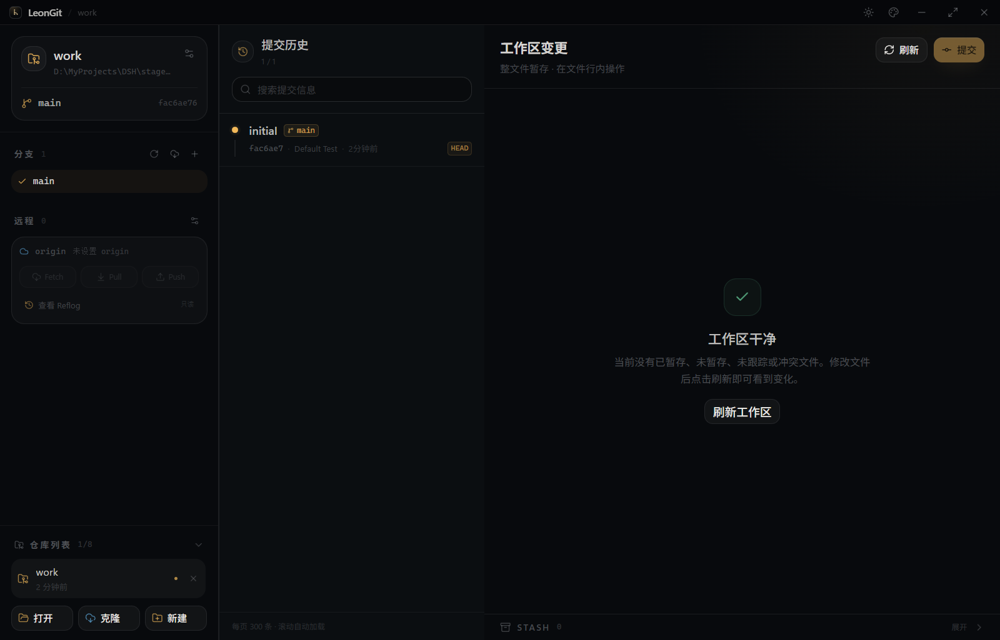

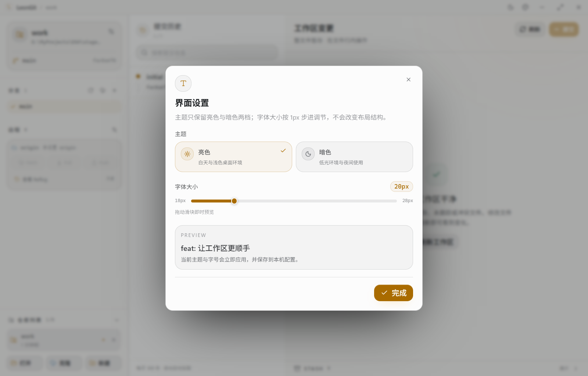

### 9. 多仓库切换

准备两个本地仓库（例如 `repo-alpha`、`repo-beta`），分别至少有一个提交，其中一个保留未提交修改。

1. 依次打开两个仓库；左栏“仓库列表”应显示 2 个条目，当前仓库高亮。
2. 在 alpha 选中一个提交/文件，切换到 beta：提交详情、diff、历史、分支、工作区应全部刷新为 beta，不残留 alpha 内容。
3. 快速连续点击 beta 与 alpha（或在历史加载中切换）：最终应只显示 alpha，旧响应不能覆盖新 UI。
4. 检查 `Data/config/repos.json`：
   ```json
   {
     "version": 1,
     "repos": [
       { "id": "repo-…", "path": "…", "name": "…", "openedAt": 0 }
     ]
   }
   ```
   条目应不超过 8 个，id 在重复打开后保持稳定。
5. 重启应用，应恢复上次打开且最近使用的仓库；清理列表中的非活动仓库后，列表与文件同步减少。
6. 左栏底部仓库列表可展开/折叠，“打开 / 克隆”固定在列表下方；当前仓库条目也显示移除按钮。
7. 只剩一个仓库时点击移除：应回到欢迎页，不残留任何旧仓库面板。
8. 在空白处点击右键：不应出现 WebView 原生菜单。

### 10. 无快捷键与界面收口

1. 按 `Ctrl/Cmd+O`、`Ctrl/Cmd+S`、`Ctrl/Cmd+P`、`Ctrl/Cmd+Enter`、`Ctrl/Cmd+=` 均不应触发任何操作。
2. 提交历史不再显示快捷键提示；分支切换使用左栏分支列表，不再有独立快速切换面板。
3. 左栏不再显示应用名称、LOCAL 标记、仓库配置/界面设置按钮；仓库配置使用当前仓库卡片右上角齿轮，界面设置使用标题栏调色板。
4. 工作区有修改时，分支区警告在亮色与暗色下都应清晰可读。

### 11. 通知位置与网络超时

1. 完成一次本地 bare 远程的 Push 或 Pull：成功通知应出现在**右下角**，不遮挡左侧仓库列表。
2. 制造一次失败（例如修改远程 URL 为不存在的路径后 Fetch）：错误提示同样出现在右下角。
3. 同时保留一条成功通知并触发错误：两条提示应在右下角纵向堆叠，而不是互相覆盖。
4. 将远程地址改为不可达地址（如 `http://10.255.255.1/repo.git`）后 Fetch/Pull：
   - 连续 30 秒无输出后应显示“连接超时”错误；
   - Git 进程及远程 helper 应被终止，不残留后台进程；
   - 界面应恢复可操作状态。

### 12. 从远程恢复已删除的本地分支

准备一个带 origin 的仓库，并存在远程分支 `feature/restore`。

1. 在本地删除 `feature/restore`：
   ```bash
   git branch -D feature/restore
   git branch -a
   # remotes/origin/feature/restore 仍存在
   ```
2. 点击分支区标题右侧的云下载图标，打开“从远程分支恢复”。
3. 列表应出现 `origin/feature/restore`；点击“检出”。
4. 验证：
   ```bash
   git branch -vv
   # * feature/restore ... [origin/feature/restore]
   ```
   左栏当前分支应切换为 `feature/restore`，历史与工作区同步刷新，右下角出现成功通知。
5. 工作区有未提交修改时重复上述操作，应被拦截并显示原因。
6. 如果列表为空，先执行 Fetch，再重新打开弹窗。

### 13. 仓库初始化

1. 新建一个空目录。
2. 左栏点击“新建”或欢迎页点击“初始化仓库”，选择该目录，可填写初始分支 `trunk`。
3. 验证：
   ```bash
   git -C <dir> symbolic-ref --short HEAD
   # trunk
   ```
4. 客户端只把仓库加入仓库列表，当前仓库与右侧面板不切换。
5. 对已有 `.git` 的目录重复初始化，应显示“该目录已经是 Git 仓库”。

### 14. 远程新增与 URL 编辑

1. 打开远程地址对话框，填写新名称 `backup` 与 URL，保存后重新打开，列表应出现 `backup`。
2. 点击已有 `origin` 的编辑按钮，修改 URL 后保存；列表与 `git remote -v` 应一致。
3. 直接用 API 对不存在的 remote 执行 set-url，应返回明确错误。
4. 确认界面没有“删除远程”入口。

### 15. 提交搜索

1. 在提交历史顶部输入 `alpha`，应只显示匹配提交，并保持虚拟滚动与分页。
2. 输入不存在的关键词，应显示“没有匹配的提交”。
3. 清空输入，应恢复普通提交历史。
4. 空 pattern 调用后端应返回“搜索关键词不能为空”。

### 16. 分支重命名

1. 点击非当前分支的铅笔图标，重命名为 `feature/renamed`，应成功。
2. 切换到该分支后再次重命名，通知应包含“远程跟踪未变”。
3. 将分支重命名为已存在的名字，应返回明确错误。
4. 验证没有自动 push，也没有修改 upstream：
   ```bash
   git branch -vv
   ```

### 17. Stash

1. 修改已跟踪文件并新增未跟踪文件，展开工作区底部 Stash，填写说明并保存。
2. 工作区应干净；`git stash list` 与界面列表一致。
3. 点击“应用”，工作区恢复修改，但 Stash 条目仍保留。
4. 清理工作区后点击“弹出”，条目应消失。
5. 制造冲突后执行弹出，应显示失败并明确“条目仍保留”；`git stash list` 仍可见。
6. 对单条 Stash 点击删除并二次确认，条目消失；界面没有“删除全部”。

### 18. Hunk 级暂存

1. 准备一个文件，在相隔较远的两处修改，确认 `git diff` 有 2 个 hunk。
2. 打开该文件 diff，只勾选 Hunk 1，点击“暂存选中 Hunk”。
3. 验证：
   ```bash
   git diff --cached -- <file>  # 只有 Hunk 1
   git diff -- <file>           # 只有 Hunk 2
   ```
4. 界面工作区应只剩 Hunk 2；切到“已暂存”应只有 Hunk 1。
5. 在“已暂存”勾选 Hunk 1 并取消暂存，验证两边归属恢复。
6. 交替执行整文件“暂存”和 hunk 取消暂存，确认无重复 hunk、无凭空消失。

### 19. Amend

1. 暂存一个文件修改，点击工作区次级入口“Amend 上次提交”。
2. 确认弹窗应显示“会改写最近一次提交的历史”；默认勾选“包含当前暂存文件”。
3. 留空消息确认，验证：
   ```bash
   git rev-list --count HEAD  # 不变
   git log -1 --format=%s     # 消息不变
   git show --stat HEAD       # 包含暂存文件
   ```
4. 再次打开 Amend，填写新消息、取消“包含当前暂存文件”，确认后消息应更新。

### 20. 分支合并

1. 当前分支与非当前分支各有一个不冲突提交，点击非当前分支合并图标，确认合并成功。
2. 验证 `git log --oneline --graph` 出现合并结果，且没有自动 push。
3. 准备冲突分支，合并后应提示“合并产生冲突”，冲突文件进入 V1 冲突分组。
4. 工作区有未提交修改时点击合并，应被明确拦截，且不会生成 stash。

### 21. 提交并推送

1. 暂存文件，打开提交弹窗，填写标题，点击“提交并推送”。
2. 验证成功通知包含 commit SHA，远程分支指向新提交。
3. 将 origin 改为不可达路径，再提交并点击“提交并推送”。
4. 应提示“提交成功，推送失败”，本地 commit 仍存在；不得 reset。
5. 恢复 origin 后点击远程区 `Push` 并确认，push 应成功。
6. 对无 upstream 的分支首次提交并推送，验证 `--set-upstream` 生效。

### 22. 文件历史

1. 准备一个发生过重命名的文件，并制造一次包含该文件的合并提交。
2. 在文件 diff 标题栏点击时钟按钮。
3. 列表应连续出现重命名前后的提交；重命名节点显示“重命名自 <old_path>”。
4. 合并提交中修改该文件的记录应出现。
5. 滚动到底部应加载下一页；空文件/未跟踪文件显示明确空状态。

### 23. Blame

1. 在文件 diff 标题栏点击人像按钮。
2. 每行左侧显示 SHA、作者、时间与行内容；归属范围与 `git blame --line-porcelain` 一致。
3. 点击任意归属行应打开 V1 提交详情。
4. 打开超过 2000 行的文件，滚动应流畅；界面提示虚拟滚动/大文件分段渲染。
5. 非 UTF-8 或超过 5 MiB 的文件应明确报错，而不是冻结。

### 24. Tag

1. 分支区标题栏点击标签按钮。
2. 默认附注标签；填写名称、目标 SHA、消息，创建后提示“标签仅存在于本地，不会自动推送”。
3. 创建轻量标签，列表中应分别标注“附注”和“轻量”。
4. 删除标签时先出现“确认删除？”，确认后从列表与 `git tag` 消失。
5. 界面没有 push tag 或批量删除入口。

### 25. 复用提交信息

1. 暂存文件，打开提交编辑器，点击“从历史复用消息”。
2. 选择一条包含正文的历史提交；标题与正文应填入，且可编辑。
3. 默认不覆盖作者；勾选“同时复用作者信息”后提交。
4. 验证提交 message 与作者：
   ```bash
   git log -1 --format='%an <%ae>%n%B'
   ```
5. 后端不得使用 `git commit -C`。

### 26. 行级丢弃

1. 在含两个 hunk 的未暂存文件中，打开 diff，勾选第一个 hunk 的部分变更行。
2. 点击“丢弃选中行”，确认弹窗应包含文件名、行范围和“此操作不可恢复，丢弃的修改不会进入 stash 或任何备份”。
3. 确认后工作区只恢复选中行，其他 hunk/行保持。
4. diff 视图立即刷新；不提供撤销按钮。

### 27. Revert

1. 在提交详情点击 Revert，确认后对无冲突提交执行；应生成反向提交。
2. 对冲突提交执行 Revert，工作区应显示“revert 进行中”，continue/abort 均可见。
3. 冲突未解决时点击 continue，应被阻止并提示。
4. 解决并标记冲突后 continue，应完成；abort 需确认并清理状态。
5. 关闭客户端后重新打开，`.git/REVERT_HEAD` 存在时仍显示“revert 进行中”。

### 28. 跳过 Git 钩子

1. 在仓库放一个会失败的 `pre-commit` 钩子。
2. 正常提交应失败。
3. 在提交编辑器“更多”中启用“跳过 Git 钩子”，应显示“将跳过 pre-commit 和 commit-msg 钩子，可能绕过代码检查”。
4. 提交成功；重新打开编辑器时开关应恢复默认关闭，不持久化。

### 29. DAG 只读视图

1. 打开一个有合并提交的仓库，提交历史右上角应显示“列表 / DAG”切换，默认仍是列表。
2. 点击“DAG”，左侧出现泳道；首条提交在最左泳道，合并提交处应看到汇入曲线，分叉处应出现新泳道。
3. 切换回“列表”，行内容与切换前一致；再切回 DAG，已加载行不重新请求（DevTools Network 无新的 `list_commits` 调用）。
4. 滚动到底部继续加载下一页，泳道线应跨页连续，不出现断裂或跳列。
5. 点击 DAG 行，右侧仍打开同一提交详情；输入搜索词时 DAG 按钮禁用并自动回到列表，清空搜索后恢复。
6. 用大型仓库验证：5k commits 首屏可正常显示；50k commits 只先加载 300 条，滚动增量加载时界面不冻结。
7. 在 DAG 视图中确认没有任何写入入口（不能拖拽、不能 rebase/cherry-pick），切换分支或刷新仓库后 DAG 重新从第一页构建。
8. 在有 20 条以上并行泳道的仓库中确认泳道区会自动加宽、超出上限时间距压缩，最右侧节点和连线仍在画布内，不出现被裁掉一半的节点。
9. 点击提交列表后按 `↑` / `↓` / `Home` / `End`：高亮在行间移动，右侧详情保持上一次选中项；按 `Enter` 或空格才打开当前高亮提交。在搜索框内按 `↑` / `↓` 不应移动提交高亮。

## 写入确认

丢弃修改、删除未合并分支和 Push 统一使用同一种确认弹窗结构：

- 标题 + 影响说明
- 目标分支/文件/远程地址卡片
- 明确的风险提示
- `取消` 与危险/确认按钮分离

提交使用提交面板复核，展示完整已暂存 diff；标题为空时不会提交。分支切换、Pull 和提交会先检查工作区状态，不会静默覆盖本地修改。

## 已知限制

- 不内置三栏合并编辑器；冲突通过系统 Git 配置的 `merge.tool` 处理。
- 不支持交互式 rebase、cherry-pick、worktree、submodule、Git LFS。
- Revert 冲突不会自动 continue 或 abort；必须由用户解决后显式操作。
- 行级丢弃仅适用于未暂存工作区 diff；不提供撤销，确认后不可恢复。
- Hunk 级暂存只覆盖普通修改文件；二进制、截断 diff、重命名文件和未跟踪文件仍走整文件或 V1 路径。
- Hunk 暂存不提供行级选择；行级能力仅用于丢弃未暂存行。
- “跳过 Git 钩子”只对当次提交生效，不提供始终跳过的配置。
- 文件历史依赖 Git `--follow` 的单文件跟随和重命名检测；跨多路径的合并历史不做图形化聚合。
- Blame 只显示文本文件；单文件上限 5 MiB，非 UTF-8/二进制内容明确报错；>2000 行使用虚拟滚动。
- Tag 仅本地创建/删除，不提供 push tag、批量删除或远程标签同步。
- 复用作者信息走 `--author`，只影响提交作者；提交者仍使用仓库 Git 配置。
- Hunk patch 只按 `@@` 与完整 diff 行应用，不提供行级暂存选择。
- 非 UTF-8 文件路径会明确停止操作，避免路径被替换后误写文件；非 UTF-8 文本 diff 会标记为不可 hunk 操作。
- 远程列表和错误信息会对 HTTP(S) userinfo 脱敏；应用不保存任何密码或 token。
- Amend 只改写最近一次提交；不提供修改更早提交或交互式 rebase。
- 分支合并只支持本地分支，不自动 stash、不自动 push；冲突由用户通过外部合并工具解决。
- 提交并推送的 push 失败不会回滚 commit；重试使用现有 Push 入口，不支持 force push。
- 仓库初始化只支持已存在目录；不会自动打开新仓库。
- 远程只支持新增与修改 URL，不支持删除远程。
- 提交搜索只按提交信息 grep，不提供作者/时间/路径等高级过滤。
- 分支重命名只改本地 ref，不自动 push，也不自动改 upstream。
- Stash 应用/弹出使用 `--index` 选项；冲突时弹出失败、条目保留。
- DAG 只读：不提供拖拽、交互式 rebase、cherry-pick 等任意写入入口，也不跨仓库展示。
- DAG 泳道布局按 commit 时间线自上而下推进；只对已加载分页布局，未加载的父提交留空等待下一页补齐。
- DAG 只在完整历史下可用；提交搜索期间按钮禁用，因为过滤结果缺少父提交，无法形成连续图。
- 泳道区宽度在 140–220px 之间随最大泳道数增长；到达上限后间距压缩，节点与连线始终留在画布内，但极宽历史会变得密集。
- 不提供全局快捷键；键盘导航仅限提交历史内部的焦点移动与打开详情，不影响搜索框等其他输入。
- 文件历史中 `-m` 会为合并提交的每个父提交重复输出提交头；客户端按 oid 去重，合并提交只展示一次，重命名信息保留首次出现的那一段。
- 分支聚焦高亮未实现；当前只提供选中行高亮。
- 提交历史为扁平列表与 Canvas DAG 二选一，默认列表；DAG 只占用左侧泳道区，右侧摘要信息与列表一致。
- 图布局缓存在已加载页范围内保留；切换仓库、搜索或刷新时重建，不跨仓库复用。
- 不提供“万能撤销”；Reflog 只读。
- 不支持 force push，也不支持远程分支删除、重命名或直接编辑上游。
- 多仓库为“切换”而不是并行标签页/工作区；不提供跨仓库合并，最多保留 8 个仓库入口。
- 远程分支只支持“从已 Fetch 的引用恢复到本地同名分支”；不支持远程分支删除、重命名或直接检出为不同名字。
- 主题只有亮色与暗色两态，不跟随系统；字体为 18–28px、1px 步进的滑块，不是自由缩放或原生缩放。
- 远程操作采用 30 秒无输出判定超时、600 秒绝对上限；极大仓库或极慢网络可能被中断，需重新执行。
- 客户端不保存密码/token；HTTPS/SSH 认证由系统 Git 凭据管理器处理。

## 完整日常闭环验收

以下清单已在本地 bare 远程 + 两个克隆（work / peer）的测试仓库执行通过。路径可按本机调整。

- [x] **打开仓库**：启动后恢复仓库列表中的最近仓库，三栏都有内容，无空白面板。
- [x] **修改**：修改 `README.md` 并新增未跟踪文件 `notes.txt`。
- [x] **脏工作区拦截**：直接点击其他分支，出现“工作区有未提交修改，切换分支会被拦截”的高对比度提示，HEAD 保持 `main`。
- [x] **逐文件暂存**：在 README.md 和 notes.txt 行内点击“暂存”：
  ```bash
  git -C work status --short
  # M  README.md
  # A  notes.txt
  ```
- [x] **提交按钮**：点击右栏“提交”，检查暂存 diff 后填写标题并提交：
  ```bash
  git -C work log -1 --format=%s
  # feat: daily commit
  ```
- [x] **分支列表切换**：在左栏分支列表点击 `feature/polish`，再点击 `main`：
  ```bash
  git -C work rev-parse --abbrev-ref HEAD
  # main
  ```
- [x] **提交详情**：点击提交历史中的任意一行，显示 SHA、作者、文件列表与 diff。
- [x] **Fetch**：peer 推送后执行 Fetch，工作区文件内容不变，分支出现 behind 数：
  ```bash
  git -C work status --short
  git -C work log -1 --oneline origin/main
  ```
- [x] **Pull**：执行 Pull，当前分支快进到 peer 提交。
- [x] **Push**：本地提交后点击 Push，确认弹窗后推送成功：
  ```bash
  git -C work status --short --branch
  # ## main...origin/main
  ```
- [x] **冲突**：peer 与 work 修改同一行，peer 先推，work 执行 Pull：
  ```bash
  git -C work diff --name-only --diff-filter=U
  # app.txt
  ```
  右栏出现独立“冲突”分组，diff 中显示冲突标记；提示条与错误提示在暗色下可读。
- [x] **标记已解决**：手动写入解决后的内容，点击“标记已解决”：
  ```bash
  git -C work status --short
  # M  app.txt
  ```
- [x] **完成合并**：再次点击“提交”，提交合并结果。
- [x] **Reflog**：打开 Reflog，最近一条为 `HEAD@{0}`，可看到 merge commit 的完整 SHA：
  ```bash
  git -C work reflog -5
  ```

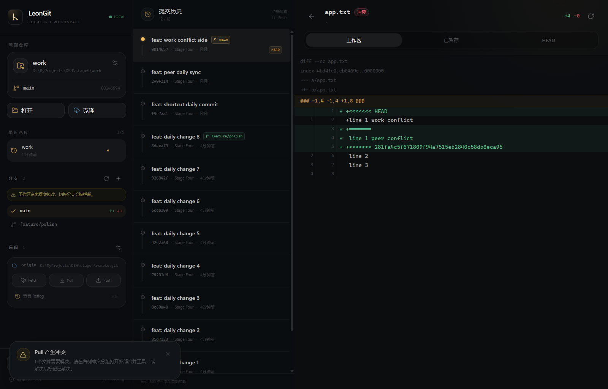

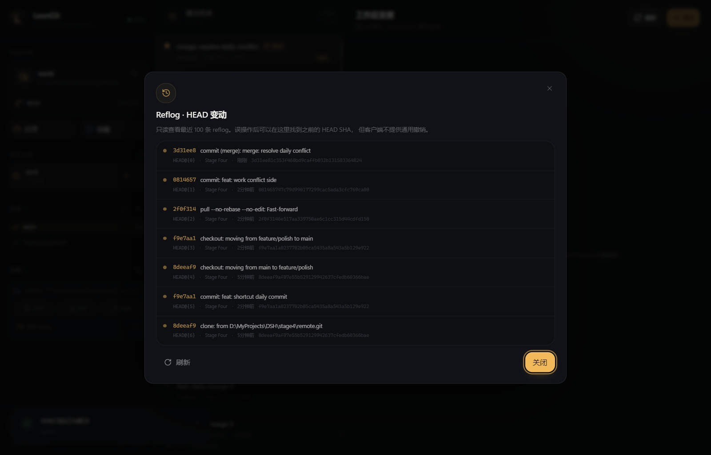

## 安全与边界

- 不保存密码/token；HTTPS/SSH 认证由系统 Git 凭据管理器处理。
- 远程 URL 不允许内嵌 HTTP(S) 凭据。
- Push 不执行 force push。
- Pull 固定 `--no-rebase`。
- 外部合并工具是用户系统 Git 配置；应用不内置三栏编辑器。
- 未解决冲突存在时 Push 被阻止。
- 分支切换、Pull、提交、分支删除、丢弃均有明确确认或拦截。
